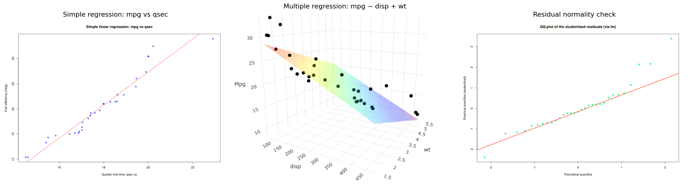

# Fuel Consumption: Linear Regression From Scratch (R)

Simple and multiple linear regression implemented from scratch in R (normal equations solved by hand, no `lm()` used for the estimation itself), applied to the `mtcars` dataset to explain a car's fuel efficiency (mpg) from its technical characteristics. Every custom result is cross-checked against R's built-in `lm()`.

Academic group project (3 students), MAM3, Polytech Nice Sophia, Applied Statistics.



## Approach

1. **Variable selection**: `mpg` is compared against each candidate quantitative variable (`disp`, `carb`, `gear`, `cyl`, `wt`, `qsec`) taken one at a time, using R² as a first filter, then a few multi-variable combinations are compared (see the table below).
2. **Simple regression**: closed-form least squares estimation (`a`, `b`) of `mpg` as a function of `qsec`, validated with:
   - R² computed by hand and compared to `lm()`'s value,
   - a Kolmogorov-Smirnov test on the standardized/studentized residuals to check the Gaussian noise assumption,
   - a t-test on the slope,
   - a 95% prediction interval.
3. **Multiple regression**: same approach with two explanatory variables (`disp` and `wt`), using matrix normal equations, an F-test for global significance, and 95% confidence intervals for each coefficient, plus a 3D visualization of the regression plane.

The presentation slides (`docs/slides.pdf`, in French) walk through the full analysis and the interpretation of the results.

### R² comparison (from the exploratory analysis)

Single explanatory variable:

| Variable | disp | carb | gear | cyl | wt | qsec |
|---|---|---|---|---|---|---|
| R² | 0.939 | 0.838 | 0.852 | 0.708 | 0.936 | 0.936 |

Combinations kept for the multiple regression:

| Variables | disp + wt | disp + qsec | wt + qsec | disp + wt + qsec |
|---|---|---|---|---|
| R² | 0.787 | 0.744 | 0.830 | 0.830 |
| Adjusted R² | 0.772 | 0.726 | 0.818 | 0.811 |

## Repository structure

```
fuel-consumption-linear-regression/
├── src/
│   ├── simple_regression.R      # mpg ~ qsec, from scratch, full validity checks
│   └── multiple_regression.R    # mpg ~ disp + wt, from scratch, 3D plot, validity checks
├── results/                     # Generated figures
├── assets/                      # Visuals used in this README
└── docs/
    └── slides.pdf                # Presentation slides (French)
```

## Installation

```bash
git clone https://github.com/<your-username>/fuel-consumption-linear-regression.git
cd fuel-consumption-linear-regression
```

The scripts only need base R plus the `plotly` package (for the 3D plot in `multiple_regression.R`):

```r
install.packages("plotly")
```

## Usage

```bash
Rscript src/simple_regression.R
Rscript src/multiple_regression.R
```

Both scripts print their statistical test results to the console and open their plots (the 3D regression plane in `multiple_regression.R` is interactive, rendered through `plotly`).

## Results

The single-variable model (`mpg ~ qsec`) reaches an R² of 0.94: quarter-mile time alone explains most of the variation in fuel efficiency in this sample. Residuals pass the Kolmogorov-Smirnov normality check (p-value 0.56-0.58 depending on the exact test), and the slope is significantly different from zero. The two-variable model (`mpg ~ disp + wt`) reaches an adjusted R² of 0.77 with a significant global F-test (p-value below 1e-9) and Gaussian residuals (KS p-value 0.24).

Note: one bug in the original script was fixed (a Kolmogorov-Smirnov test result that was used before being assigned to a variable), and the axis labels on the simple regression plot were corrected to match what is actually plotted (`qsec` and `mpg`, not displacement and consumption in L/100km).

## Authors

Group project by Matthieu Keruzoret, Petru Piculescu and Camille Veillon.
